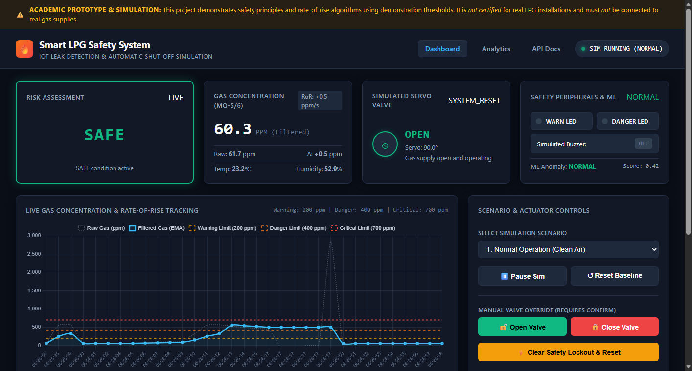
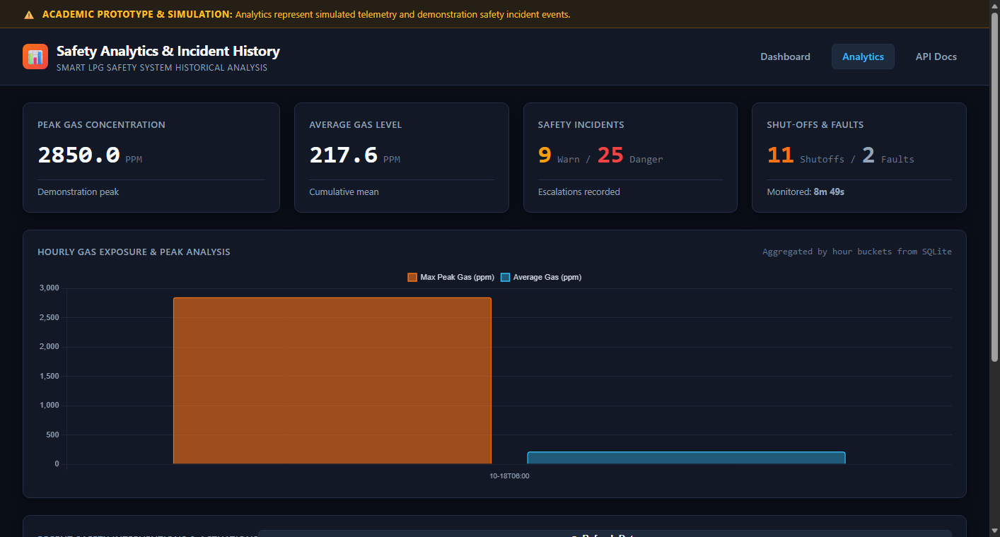

# Smart LPG Leak Detection & Automatic Shut-Off System

[](https://www.python.org/downloads/)
[](https://fastapi.tiangolo.com/)
[](https://docs.pytest.org/)
[](LICENSE)
[]()

> **An IoT-based safety supervisory system that continuously monitors LPG/gas concentration, detects abnormal surges using rate-of-rise algorithms, classifies risk across multi-level thresholds, and commands an automated simulated shut-off valve with safety lockout protection.**

---

> [!WARNING]
> ### Critical Safety Disclaimer
> This project is an **academic simulation and educational prototype**. 
> - It is **NOT certified** for real-world commercial or residential LPG installations.
> - It must **NEVER** be connected to a live pressurized gas supply or used in life-critical environments.
> - All gas thresholds and rate-of-rise metrics provided in the default configuration are **demonstration values**.
> - The shut-off mechanism is modeled as a software-simulated servo actuator.

---

## Table of Contents
- [Overview](#overview)
- [Problem Statement](#problem-statement)
- [Objectives](#objectives)
- [Key Features](#key-features)
- [System Architecture](#system-architecture)
- [How It Works](#how-it-works)
- [Risk Detection & Demonstration Thresholds](#risk-detection--demonstration-thresholds)
- [Rate-of-Rise (RoR) Detection](#rate-of-rise-ror-detection)
- [Automatic Shut-Off & Lockout Hysteresis](#automatic-shut-off--lockout-hysteresis)
- [Sensor Fault & Plausibility Diagnostics](#sensor-fault--plausibility-diagnostics)
- [Machine Learning Anomaly Detection](#machine-learning-anomaly-detection)
- [Web Dashboard & Historical Analytics](#web-dashboard--historical-analytics)
- [Technology Stack](#technology-stack)
- [Project Structure](#project-structure)
- [Installation](#installation)
- [Running the Project](#running-the-project)
- [Simulation Scenarios](#simulation-scenarios)
- [API Documentation](#api-documentation)
- [Testing](#testing)
- [Sample Simulation Results](#sample-simulation-results)
- [Optional Hardware Integration](#optional-hardware-integration)
- [Limitations](#limitations)
- [Future Improvements](#future-improvements)
- [Author & License](#author--license)

---

## Overview

Liquefied Petroleum Gas (LPG)—predominantly composed of propane and butane—is an essential fuel worldwide. Because LPG is heavier than air, leaks pool at floor level and can rapidly accumulate into flammable or explosive concentrations. 

The **Smart LPG Leak Detection & Automatic Shut-Off System** addresses this hazard through a multi-tiered defense architecture. Instead of waiting for gas to cross dangerous static concentrations, the system introduces **dynamic Rate-of-Rise (RoR) monitoring** to flag rapid gas build-ups in their earliest stages, triggers escalating visual and acoustic annunciators, and automatically closes a simulated emergency shut-off valve with latching safety lockout logic.

---

## Problem Statement

Traditional low-cost residential gas alarms suffer from two major architectural flaws:
1. **Static Threshold Blindness:** They only trigger after gas has already accumulated to a high concentration (e.g., 400+ ppm). In cases of a high-pressure line burst or severed hose, critical evacuation and isolation time is lost.
2. **Nuisance Tripping & Valve Chattering:** Sensor jitter near threshold boundaries causes actuators to rapidly oscillate on and off, inducing mechanical fatigue and erratic alarms.
3. **Sensor Drift & Unmonitored Failures:** Many consumer alarms fail silently when sensing elements burn out, lose power, or become disconnected.

---

## Objectives

1. Develop a high-fidelity **Python sensor simulation** reproducing MQ-5/MQ-6 semiconductor sensor response curves, ambient thermal drift, and Gaussian analog noise across 7 operational scenarios.
2. Implement an **Exponential Moving Average (EMA)** filter to eliminate sensor jitter while preserving step response.
3. Formulate a **Rate-of-Rise ($\frac{dGas}{dt}$)** algorithm to detect fast gas leaks before absolute concentration thresholds are breached.
4. Model a **servo-actuated shut-off valve** featuring finite-state transition mechanics, anti-chattering hysteresis, and latching safety lockout.
5. Provide continuous **sensor health monitoring** capable of diagnosing missing readings, stuck values, unrealistic spikes, and timeouts.
6. Deliver a professional, responsive **dark-mode SCADA dashboard** and **historical analytics suite** built with Vanilla JavaScript and Chart.js.
7. Incorporate an **advisory Machine Learning anomaly detector** (scikit-learn Isolation Forest) while enforcing the strict architectural principle that deterministic safety rules always retain absolute authority.

---

## Key Features

- **Multi-Level Risk Classification:** Real-time stratification into `SAFE`, `WARNING`, `DANGER`, and `CRITICAL` states.
- **Rate-of-Rise (RoR) Surge Detection:** Evaluates gas delta per second ($\Delta Gas / \Delta t$) to escalate safety response immediately upon detecting sharp surges.
- **Simulated Servo Actuator (90° to 0°):** Models physical stroke transition time (`OPEN` $\to$ `CLOSING` $\to$ `CLOSED`).
- **Safety Lockout Hysteresis:** Latches the valve shut once emergency isolation occurs; prevents automatic reopening until environmental gas clears and an operator explicitly confirms a system reset.
- **Multi-Level Escalating Alerts:** Visual LEDs (Warning Amber, Danger Red), simulated pulsed/continuous acoustic buzzers, and automated system incident logs.
- **7 Injectable Simulation Scenarios:** Normal clean air, slow leak, sudden catastrophic leak, rapid spike, noisy sensor, ventilation recovery, and sensor failure modes.
- **Sensor Fault Detection:** Diagnoses disconnected/null readings, out-of-range impossible values, frozen ADCs, and communication timeouts.
- **Persistent SQLite Audit Log:** Records telemetry readings and state change incidents with query filtering and aggregations.
- **Historical Analytics Page:** Displays lifetime max/avg gas levels, incident counts, hourly exposure charts, and incident tables.
- **MQTT Telemetry Publisher:** Paho-MQTT integration that broadcasts telemetry and alerts with graceful offline fallback when no broker is running.

---

## System Architecture

```mermaid
flowchart TD
    subgraph SENSING ["Sensing & Simulation Layer"]
        Sim["Sensor Simulator<br/>(7 Operational Scenarios)"]
        Raw["Raw Telemetry Stream<br/>(Gas PPM, Temp, Hum)"]
        Sim --> Raw
    end

    subgraph SIGNAL ["Signal Conditioning & Diagnostics"]
        Health{"Sensor Health &<br/>Plausibility Monitor"}
        EMA["EMA / SMA Digital Filter<br/>(Noise Reduction)"]
        RoR["Rate-of-Rise (RoR) Engine<br/>(dGas / dt)"]
        
        Raw --> Health
        Health -- "Nominal" --> EMA
        Health -- "FAULT" --> FaultAlert["Sensor Fault Alert"]
        EMA --> RoR
    end

    subgraph RISK ["Deterministic Safety Core"]
        RiskEngine{"Deterministic<br/>Risk Classifier"}
        EMA --> RiskEngine
        RoR --> RiskEngine
        FaultAlert --> RiskEngine
    end

    subgraph ACTUATION ["Actuation & Annunciation"]
        Valve["Simulated Servo Valve<br/>(OPEN / CLOSING / CLOSED)"]
        Lockout["Safety Lockout Latch<br/>(Hysteresis Protection)"]
        Alerts["Alert Manager<br/>(LEDs & Pulsed Buzzer)"]
        
        RiskEngine --> Lockout --> Valve
        RiskEngine --> Alerts
    end

    subgraph PERSISTENCE ["Storage & Delivery"]
        DB[("SQLite Database<br/>(Readings & Incidents)")]
        MQTT["MQTT Publisher<br/>(Telemetry & Alarms)"]
        API["FastAPI REST Engine"]
        Dash["Web Dashboard & Analytics<br/>(Chart.js SCADA Console)"]

        RiskEngine --> DB
        RiskEngine --> MQTT
        DB --> API
        API --> Dash
    end

    subgraph ADVISORY_ML ["Advisory Intelligence Layer"]
        IsoForest["Isolation Forest<br/>(scikit-learn ML)"]
        MLAlert["Anomaly Diagnostics<br/>(Advisory Only)"]
        
        EMA -.-> IsoForest
        RoR -.-> IsoForest
        IsoForest --> MLAlert
        MLAlert -.-> Dash
    end

    style RISK fill:#1e293b,stroke:#ef4444,stroke-width:2px;
    style ADVISORY_ML fill:#1e293b,stroke:#38bdf8,stroke-width:2px,stroke-dasharray: 5 5;
```



---

## How It Works

1. **Telemetry Generation:** Every 1.0 second, the simulator generates gas concentration (in PPM), temperature (°C), and humidity (%).
2. **Plausibility & Fault Check:** The raw reading is checked for out-of-range values ($< 0$ or $> 2500$ ppm), physical discontinuity ($> 350$ ppm/s), stuck analog values, or communication drops.
3. **Signal Conditioning:** The raw reading is smoothed using an Exponential Moving Average ($\alpha = 0.25$) to eliminate noise.
4. **RoR Calculation:** The system calculates the rate-of-change ($\text{PPM/sec}$).
5. **Deterministic Evaluation:** The filtered value and rate-of-rise are checked against safety thresholds and deadbands.
6. **Actuation & Annunciation:** The servo controller transitions the valve (`OPEN`, `CLOSING`, or `CLOSED`), updates warning/danger LEDs, and sets buzzer mode (`OFF`, `BEEPING`, `CONTINUOUS`).
7. **Persistence & Telemetry:** Telemetry and state transitions are committed to SQLite and dispatched via MQTT and REST API.

---

## Risk Detection & Demonstration Thresholds

All thresholds are isolated in [backend/config.py](file:///c:/Users/jothi/Downloads/smart-lpg-safety-system/backend/config.py) and can be configured via environment variables.

| Risk Level | Demonstration Threshold | System Action | Annunciator State |
| :--- | :--- | :--- | :--- |
| **`SAFE`** | Gas $< 200.0$ PPM | Normal monitoring; valve remains OPEN | LEDs OFF, Buzzer OFF |
| **`WARNING`** | Gas $\ge 200.0$ PPM | Alert user; valve remains OPEN | Warning LED ON, Buzzer OFF |
| **`DANGER`** | Gas $\ge 400.0$ PPM | Emergency mitigation; valve starts `CLOSING` | Warning + Danger LED ON, Buzzer BEEPING |
| **`CRITICAL`** | Gas $\ge 700.0$ PPM or Surge | Gas isolated; valve driven to `CLOSED` (latched) | Warning + Danger LED FLASHING, Buzzer CONTINUOUS |

---

## Rate-of-Rise (RoR) Detection

Standard static concentration alarms can take minutes to trigger during early leak development. The RoR engine detects the rate of gas concentration increase per second:

$$\text{Rate Per Second} = \frac{\text{Gas}_t - \text{Gas}_{t-1}}{\Delta t}$$

- **Configurable RoR Threshold:** Default = `25.0 PPM / second`.
- **Surge Escalation Logic:** If the rate-of-rise meets or exceeds this threshold:
  - If current condition is `SAFE` or `WARNING`, it escalates immediately to **`DANGER`**.
  - If current condition is `DANGER`, it escalates to **`CRITICAL`**.
  - A `RAPID_GAS_RISE` event is logged to the database.
  - The simulated buzzer sounds immediately to alert occupants.

---

## Automatic Shut-Off & Lockout Hysteresis

The simulated valve models an industrial solenoid or quarter-turn ball valve actuated by a 90° servo motor:

- **Angle Mapping:** $90^\circ = \text{Fully OPEN}$ | $45^\circ = \text{In Transition / CLOSING}$ | $0^\circ = \text{Fully CLOSED}$.
- **Hysteresis Band ($30.0 \text{ PPM}$):** If gas rises to 210 ppm (`WARNING`), it does not drop back to `SAFE` until gas falls below $200.0 - 30.0 = 170.0 \text{ PPM}$.
- **Safety Lockout Latch:** When the valve closes due to a `DANGER` or `CRITICAL` event, it **latches in the CLOSED position**. Even if gas concentration disperses back to clean air levels, the valve **will not automatically reopen**. It requires an operator to inspect the area and confirm a **System Reset** via the UI.
- **Manual Overrides with UI Confirmation:** Operators can manually command `OPEN VALVE` or `CLOSE VALVE`. Any manual command opens an interactive confirmation modal to prevent accidental activation. Manual valve opening is strictly blocked by safety interlocks if an active hazardous gas concentration is present.

---

## Sensor Fault & Plausibility Diagnostics

A dedicated `SensorHealthMonitor` verifies signal integrity before processing:

| Fault Condition | Detection Logic | Resulting Status | System Action |
| :--- | :--- | :--- | :--- |
| **Missing / Null Reading** | `raw_gas is None` or `math.isnan(raw_gas)` | `FAULT` | Elevates alert to `WARNING`, logs `SENSOR_FAULT` |
| **Impossible Negative Value**| `raw_gas < 0.0` PPM | `FAULT` | Flags sub-zero ADC wiring fault |
| **Sensor Saturation** | `raw_gas > 2500.0` PPM | `FAULT` | Flags ADC saturation limit exceeded |
| **Physically Impossible Jump**| Rate $\Delta Gas / \Delta t > 350.0$ PPM/s | `FAULT` | Catches electrical spikes and short circuits |
| **Stuck Sensor Values** | 8 consecutive identical readings | `WARNING` | Flags loss of natural analog noise / frozen ADC |
| **Watchdog Timeout** | Telemetry delay $\Delta t > 5.0$ seconds | `FAULT` | Flags communication bus failure |

---

## Machine Learning Anomaly Detection

The system includes an optional **Isolation Forest** anomaly detector trained via `scikit-learn`:

- **Multivariate Feature Vector:** Analyzes `[gas_concentration, rate_per_second, temperature, humidity]`.
- **Nominal Baseline Fitting:** Trained on typical ambient variations to generate decision boundary scores.
- **Strict Architectural Priority:** 
  > [!IMPORTANT]
  > **The ML model operates in an ADVISORY capacity only.**
  > Machine learning predictions NEVER override or disable deterministic safety rules. The deterministic rule engine retains absolute physical authority over actuator shut-offs.

---

## Web Dashboard & Historical Analytics

The frontend consists of two responsive web consoles:

### 1. Real-Time Supervisory Dashboard (`/`)
- **Large Risk Hero Card:** Visual status card displaying current condition (`SAFE`, `WARNING`, `DANGER`, `CRITICAL`) with dynamic color transitions and alert pulses.
- **Telemetry Readouts:** Filtered gas (PPM), Raw gas (PPM), Rate-of-Change, Ambient Temperature (°C), and Humidity (%).
- **Interactive Servo Graphic:** Real-time valve state (`OPEN`, `CLOSING`, `CLOSED`), servo angle ($0^\circ-90^\circ$), and actuator source.
- **Live Chart.js Graph:** Rolling telemetry chart displaying raw signal, filtered EMA signal, and threshold limit lines.
- **Scenario Injector:** Select and run any of the 7 operational simulation scenarios.
- **Manual Valve Controls:** Confirmed overrides for Open, Close, and Safety Reset.
- **Filterable Event Log:** Live table of recent system events filterable by type and risk level.



### 2. Historical Safety Analytics (`/analytics.html`)
- **Key Performance Indicators (KPIs):** Lifetime peak gas concentration, average gas concentration, total warnings, dangerous incidents, automatic shut-offs, and sensor fault counts.
- **Hourly Exposure Chart:** Aggregated hourly average vs peak gas levels from SQLite database records.
- **Incident Audit Trail:** Complete chronological record of historical safety interventions.



---

## Technology Stack

- **Backend:** Python 3.11+, FastAPI, Uvicorn, Pydantic v2, Python-Dotenv
- **Database:** SQLite3 (thread-safe connection pool, indexed tables)
- **Data & ML:** NumPy, Pandas, scikit-learn (Isolation Forest)
- **IoT & Networking:** Paho-MQTT (Mosquitto compatible with automatic graceful offline fallback)
- **Frontend:** HTML5, CSS3 (Custom SCADA Dark Theme), Vanilla JavaScript (ES6+), Chart.js
- **Testing:** pytest, HTTPX, Starlette TestClient

---

## Project Structure

```
smart-lpg-safety-system/
│
├── backend/
│   ├── __init__.py               # Backend package initializer
│   ├── app.py                    # FastAPI application factory and static file serving
│   ├── config.py                 # Central demonstration thresholds & parameters
│   ├── database.py               # SQLite storage manager and analytics aggregations
│   ├── models.py                 # Pydantic schemas, Enums, and request/response models
│   ├── mqtt_client.py            # Paho-MQTT telemetry publisher with offline fallback
│   ├── routes.py                 # REST API endpoints
│   ├── service.py                # Core orchestration service and background worker
│   │
│   ├── sensors/
│   │   ├── __init__.py           # Sensors package initializer
│   │   ├── gas_sensor.py         # EMA filtering and SensorHealthMonitor diagnostics
│   │   └── simulator.py          # 7-scenario realistic gas & environmental generator
│   │
│   ├── safety/
│   │   ├── __init__.py           # Safety package initializer
│   │   ├── risk_engine.py        # Deterministic risk engine with hysteresis & RoR
│   │   ├── valve_controller.py   # Servo actuator logic, lockout latch, & manual overrides
│   │   └── alert_manager.py      # Escalating acoustic buzzer & visual LED outputs
│   │
│   └── ml/
│       ├── __init__.py           # ML package initializer
│       └── anomaly_detector.py   # scikit-learn Isolation Forest model (advisory)
│
├── frontend/
│   ├── index.html                # Real-time SCADA safety monitoring console
│   ├── analytics.html            # Historical KPI analytics and hourly exposure graphs
│   ├── css/
│   │   └── style.css             # Responsive industrial dark theme stylesheet
│   └── js/
│       ├── dashboard.js          # Polling engine, Chart.js updates, & modal logic
│       └── analytics.js          # Analytics page data loader & chart renderer
│
├── hardware/
│   ├── README.md                 # Physical microcontroller wiring guide & BOM
│   └── esp8266_lpg_safety.ino    # Optional NodeMCU ESP8266/Arduino C++ firmware
│
├── tests/
│   ├── __init__.py               # Tests package initializer
│   ├── test_risk_engine.py       # Unit tests for risk levels, RoR, and hysteresis
│   ├── test_valve_controller.py  # Unit tests for actuator stroke, lockout, & overrides
│   ├── test_sensor.py            # Unit tests for EMA filter, health checks, & scenarios
│   └── test_api.py               # Integration tests for REST endpoints & event logging
│
├── data/
│   └── .gitkeep                  # Database folder placeholder (auto-generates lpg_safety.db)
│
├── docs/
│   └── architecture.md           # In-depth architectural specification and Mermaid charts
│
├── screenshots/
│   └── .gitkeep                  # Screenshots directory
│
├── .env.example                  # Environment configuration template
├── .gitignore                    # Git exclusions
├── LICENSE                       # MIT License
├── README.md                     # Comprehensive project documentation
├── requirements.txt              # Production and development dependencies
└── run.py                        # Root server launcher
```

---

## Installation

### 1. Clone the Repository
```bash
git clone https://github.com/your-username/smart-lpg-safety-system.git
cd smart-lpg-safety-system
```

### 2. Create and Activate a Virtual Environment
**On Windows (PowerShell):**
```powershell
python -m venv venv
.\venv\Scripts\Activate.ps1
```

**On Linux / macOS:**
```bash
python3 -m venv venv
source venv/bin/activate
```

### 3. Install Dependencies
```bash
pip install -r requirements.txt
```

### 4. Configure Environment (Optional)
Copy `.env.example` to `.env` if you wish to adjust demonstration thresholds:
```bash
cp .env.example .env
```

---

## Running the Project

Start the application with the root runner:
```bash
python run.py
```

Once running, access the interfaces in your browser:
- **Live SCADA Dashboard:** [http://127.0.0.1:8000](http://127.0.0.1:8000)
- **Historical Safety Analytics:** [http://127.0.0.1:8000/analytics.html](http://127.0.0.1:8000/analytics.html)
- **Interactive OpenAPI Documentation:** [http://127.0.0.1:8000/docs](http://127.0.0.1:8000/docs)

---

## Simulation Scenarios

The simulator includes 7 scenarios that can be selected from the dashboard dropdown or triggered via the API:

1. **`NORMAL` (Clean Air):** Baseline ambient readings (40–80 ppm) with realistic minor noise and nominal room temperature/humidity.
2. **`SLOW_LEAK` (Gradual Ramp):** Simulates a small fitting leak or loose valve where gas steadily climbs by $+8$ to $+14$ ppm per second.
3. **`SUDDEN_LEAK` (Catastrophic Burst):** Simulates a punctured hose or regulator failure, escalating at $+60$ to $+95$ ppm per second directly into `DANGER` and `CRITICAL`.
4. **`RAPID_SPIKE` (Surge Test):** Instantaneous high-velocity surge ($+200$ ppm/s) testing the Rate-of-Rise safety trigger before absolute thresholds are reached.
5. **`NOISY_SENSOR` (Jitter & Filtering):** Injects heavy Gaussian noise ($\pm 50$ ppm) around an elevated baseline to demonstrate the noise reduction capability of the Exponential Moving Average filter.
6. **`SENSOR_RECOVERY` (Post-Incident Ventilation):** Simulates fresh-air cross ventilation after a shut-off, decaying gas concentration back toward baseline.
7. **`SENSOR_FAILURE` (Fault Diagnostics):** Sequentially injects out-of-range negative values, missing data (`None`), out-of-bounds readings, and frozen values to demonstrate automated sensor health fault detection.

---

## API Documentation

The FastAPI service exposes clean REST endpoints:

### Endpoints Overview

| Method | Endpoint | Description |
| :--- | :--- | :--- |
| `GET` | `/api/health` | Health check, uptime status, and database connectivity. |
| `GET` | `/api/status` | Current real-time system snapshot (gas, risk, valve, alerts). |
| `GET` | `/api/sensors` | Chronological sensor telemetry points for charting (`?limit=60`). |
| `GET` | `/api/events` | Filtered event log entries (`?limit=50&event_type=...&risk_level=...`). |
| `GET` | `/api/analytics`| Aggregated safety metrics, total monitoring time, and hourly trends. |
| `POST` | `/api/simulation/start` | Resume continuous background simulation ticks. |
| `POST` | `/api/simulation/stop` | Pause background simulation ticks. |
| `POST` | `/api/scenario` | Change simulation scenario (`{"scenario": "SLOW_LEAK"}`). |
| `POST` | `/api/valve/close` | Emergency manual valve close override (`{"confirmed": true}`). |
| `POST` | `/api/valve/open` | Manual valve open command (`{"confirmed": true}`). Blocked if hazardous. |
| `POST` | `/api/system/reset` | Clear safety lockout and reset system (`{"confirmed": true}`). |

### Example Response: `GET /api/status`
```json
{
  "timestamp": "2026-10-18T06:20:00.123456+00:00",
  "risk_level": "SAFE",
  "raw_gas": 64.2,
  "filtered_gas": 63.8,
  "rate_of_change": 0.4,
  "rate_per_second": 0.4,
  "rapid_rise_detected": false,
  "temperature": 24.5,
  "humidity": 52.0,
  "valve_state": "OPEN",
  "valve_angle_deg": 90.0,
  "valve_last_source": "AUTOMATIC_RULE",
  "sensor_health": "NORMAL",
  "sensor_health_reason": "Sensor operating nominally",
  "buzzer_state": "OFF",
  "warning_led": false,
  "danger_led": false,
  "simulation_running": true,
  "active_scenario": "NORMAL",
  "is_anomaly": false,
  "anomaly_label": "NORMAL",
  "thresholds": {
    "safe_max": 199.0,
    "warning_threshold": 200.0,
    "danger_threshold": 400.0,
    "critical_threshold": 700.0,
    "rate_of_rise_threshold": 25.0,
    "hysteresis_ppm": 30.0
  }
}
```

---

## Testing

The project contains a thorough test suite using `pytest`.

To execute all tests:
```bash
pytest -v
```

### Test Coverage Highlights
- **Risk Classification:** Confirms `SAFE`, `WARNING`, `DANGER`, and `CRITICAL` state transitions.
- **Rate-of-Rise Algorithm:** Verifies that rapid acceleration ($+30$ ppm/s) escalates risk level before concentration limits are hit.
- **Hysteresis Loop:** Proves that warning and danger states maintain stability in deadbands and do not chatter.
- **Valve Actuation:** Tests transition states (`OPEN` $\to$ `CLOSING` $\to$ `CLOSED`), servo angles, and lockout persistence.
- **Safety Interlocks:** Confirms manual valve opening is rejected if hazardous gas is present.
- **Sensor Diagnostics:** Validates detection of `None`/`NaN`, negative values, out-of-range readings, stuck values, and timeouts.
- **REST API Endpoints:** Validates responses, parameter filtering, and error handling.

---

## Sample Simulation Results

Below is an excerpt from the persistent event log during a **Sudden Leak** injection:

| Timestamp (UTC) | Event Type | Risk Level | Gas (PPM) | Valve State | Action / Description |
| :--- | :--- | :--- | :--- | :--- | :--- |
| `2026-10-18 06:15:02` | `SCENARIO_CHANGED` | `SAFE` | 64.0 | `OPEN` | Scenario switched to SUDDEN_LEAK |
| `2026-10-18 06:15:03` | `RAPID_GAS_RISE` | `DANGER` | 142.5 | `CLOSING` | Rapid gas rise surge detected (+78.5 ppm/s) |
| `2026-10-18 06:15:04` | `GAS_WARNING` | `DANGER` | 225.1 | `CLOSING` | Gas concentration exceeded WARNING threshold |
| `2026-10-18 06:15:05` | `AUTOMATIC_SHUTOFF`| `DANGER` | 310.4 | `CLOSED` | Emergency shut-off completed: servo at 0.0° |
| `2026-10-18 06:15:07` | `GAS_CRITICAL` | `CRITICAL`| 715.0 | `CLOSED` | Gas concentration escalated to CRITICAL |
| `2026-10-18 06:15:20` | `SCENARIO_CHANGED` | `CRITICAL`| 715.0 | `CLOSED` | Scenario switched to SENSOR_RECOVERY |
| `2026-10-18 06:15:35` | `GAS_SAFE` | `SAFE` | 85.0 | `CLOSED` | Gas cleared to SAFE; valve remains latched CLOSED |
| `2026-10-18 06:15:42` | `VALVE_RESET` | `SAFE` | 82.1 | `OPEN` | Safety lockout cleared; system restored to OPEN |

---

## Limitations

1. **Simulation Model:** Physical gas diffusion dynamics in enclosed spaces are influenced by airflow, ceiling height, and obstacles. The current simulator uses 1-D mathematical drift rather than 3-D computational fluid dynamics (CFD).
2. **Sensor Calibration:** Real MQ-series sensors require clean-air preheating (burn-in period) and exhibit non-linear logarithmic $R_s / R_0$ resistance curves sensitive to ambient temperature and humidity.
3. **Actuator Representation:** The valve is simulated in software (and via a bench-top RC servo in the hardware sketch). Real LPG systems mandate certified solenoid or motorized ball valves with spring-return fail-safe mechanisms.

---

## Future Improvements

- [ ] Add 3-D spatial gas diffusion modeling using multi-sensor grid nodes.
- [ ] Implement cellular GSM/SMS or Push Notification alerts (via Twilio or Telegram Bot API).
- [ ] Incorporate temperature-humidity compensation curves for MQ-sensor $R_s / R_0$ calibration.
- [ ] Add WebSockets/SSE stream for sub-second telemetry delivery to client dashboards.
- [ ] Develop Docker containerization and Docker Compose setup with integrated Mosquitto broker.

---

## Safety Disclaimer

This project is strictly an educational prototype and academic proof of concept. The authors and contributors accept **no liability or responsibility** for any misuse, damage, injury, or loss arising from the use of this software, documentation, or hardware sketches. **Never attempt to control real-world flammable gas installations with uncertified prototypes.**

---

## Author & License

Developed as an IoT and Embedded Systems Software Engineering project.

Released under the [MIT License](LICENSE).
