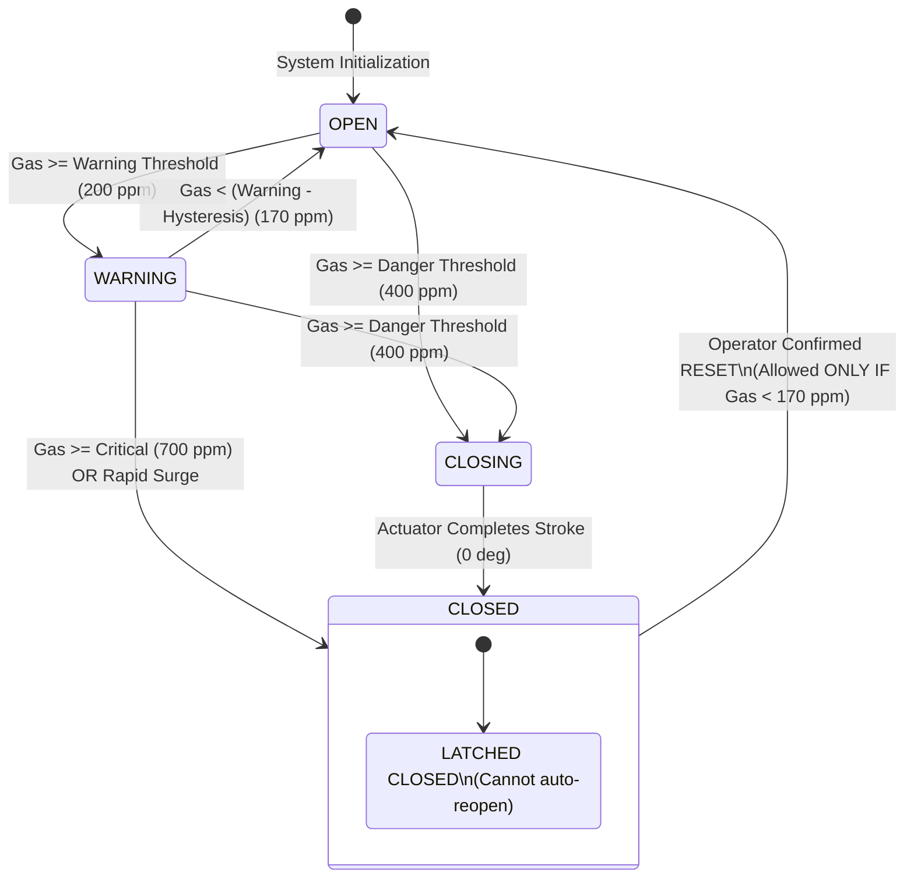

# Smart LPG Leak Detection & Automatic Shut-Off System
## System Architecture & Engineering Design Document

---

## 1. Architectural Overview

The **Smart LPG Leak Detection & Automatic Shut-Off System** is structured as a decoupled, multi-layered cyber-physical safety architecture. The system combines digital signal processing, rate-of-rise event detection, deterministic state machines, and advisory machine learning anomaly detection.

```mermaid
flowchart TD
    subgraph SENSING ["Sensing & Simulation Layer"]
        Sim["Sensor Simulator<br/>(7 Operational Scenarios)"]
        Raw["Raw Telemetry Stream<br/>(Gas PPM, Temp, Hum)"]
        Sim --> Raw
    end

    subgraph SIGNAL ["Signal Conditioning & Diagnostics"]
        Health{"Sensor Health &<br/>Plausibility Monitor"}
        EMA["EMA / SMA Digital Filter<br/>(Noise Reduction)"]
        RoR["Rate-of-Rise (RoR) Engine<br/>(dGas / dt)"]
        
        Raw --> Health
        Health -- "Nominal" --> EMA
        Health -- "FAULT" --> FaultAlert["Sensor Fault Alert"]
        EMA --> RoR
    end

    subgraph RISK ["Deterministic Safety Core"]
        RiskEngine{"Deterministic<br/>Risk Classifier"}
        EMA --> RiskEngine
        RoR --> RiskEngine
        FaultAlert --> RiskEngine
    end

    subgraph ACTUATION ["Actuation & Annunciation"]
        Valve["Simulated Servo Valve<br/>(OPEN / CLOSING / CLOSED)"]
        Lockout["Safety Lockout Latch<br/>(Hysteresis Protection)"]
        Alerts["Alert Manager<br/>(LEDs & Pulsed Buzzer)"]
        
        RiskEngine --> Lockout --> Valve
        RiskEngine --> Alerts
    end

    subgraph PERSISTENCE ["Storage & Delivery"]
        DB[("SQLite Database<br/>(Readings & Incidents)")]
        MQTT["MQTT Publisher<br/>(Telemetry & Alarms)"]
        API["FastAPI REST Engine"]
        Dash["Web Dashboard & Analytics<br/>(Chart.js SCADA Console)"]

        RiskEngine --> DB
        RiskEngine --> MQTT
        DB --> API
        API --> Dash
    end

    subgraph ADVISORY_ML ["Advisory Intelligence Layer"]
        IsoForest["Isolation Forest<br/>(scikit-learn ML)"]
        MLAlert["Anomaly Diagnostics<br/>(Advisory Only)"]
        
        EMA -.-> IsoForest
        RoR -.-> IsoForest
        IsoForest --> MLAlert
        MLAlert -.-> Dash
    end

    style RISK fill:#1e293b,stroke:#ef4444,stroke-width:2px;
    style ADVISORY_ML fill:#1e293b,stroke:#38bdf8,stroke-width:2px,stroke-dasharray: 5 5;
```

---

## 2. Deterministic Priority Principle

> [!IMPORTANT]
> **Deterministic Safety System Priority:**
> In safety-critical embedded systems, machine learning models (such as unsupervised Isolation Forests) must **never** be given unilateral veto power or direct control over life-critical actuators.
> 
> In this architecture:
> 1. **Deterministic Rules Have Absolute Authority:** If gas concentration or Rate-of-Rise exceeds safety thresholds, the valve **will close**, regardless of ML outputs.
> 2. **ML is Strictly Advisory:** The Isolation Forest analyzes multivariate trends (gas, rate, temperature, humidity) to provide predictive diagnostic warnings to operators without interfering with physical shut-off safety loops.

---

## 3. Finite State Machine (FSM): Valve Actuator & Lockout

To prevent catastrophic chattering (rapid oscillations between OPEN and CLOSED when gas lingers near a threshold boundary), the valve actuator incorporates **hysteresis deadbands** and a **safety lockout latch**.

---

## 4. Rate-of-Rise (RoR) Mathematics

Traditional gas detectors trigger only when gas reaches a fixed absolute threshold. However, in a catastrophic pipeline rupture or cylinder regulator failure, waiting for gas to reach 400 or 700 ppm wastes crucial escape and shut-off time.

The Rate-of-Rise engine continuously computes:

$$\Delta Gas = Gas_t - Gas_{t-1}$$

$$\frac{dGas}{dt} = \frac{Gas_t - Gas_{t-1}}{\Delta t}$$

Where:
- $\Delta t$: time interval between consecutive valid sensor readings (seconds)
- If $\frac{dGas}{dt} \ge 25.0 \text{ PPM/sec}$, the system triggers an immediate **`RAPID_GAS_RISE`** incident and escalates the risk level directly to **`DANGER`** or **`CRITICAL`**, initiating emergency servo valve closure immediately.

---

## 5. Exponential Moving Average (EMA) Digital Filter

MQ-series semiconductor sensors are prone to high-frequency electromagnetic interference, heater thermal cycling noise, and air drafts. To maintain crisp response without false positive tripping, an Exponential Moving Average filter is implemented:

$$y_t = \alpha \cdot x_t + (1 - \alpha) \cdot y_{t-1}$$

Where:
- $x_t$: Raw analog sensor reading at time $t$
- $y_t$: Filtered smoothed output
- $\alpha = 0.25$: Tuned smoothing factor balancing fast step response with jitter suppression.

---

## 6. Sensor Health & Plausibility Diagnostics

Before passing readings to the safety core, the sensor health monitor screens every telemetry packet:

1. **Null / NaN Check:** Catches missing packets or broken wire ADC disconnects.
2. **Range Verification:** Flags impossible negative readings ($< 0.0$ ppm) or saturation ($> 2500.0$ ppm).
3. **Discontinuous Jump Check:** Detects electrical short-circuits or spikes exceeding $\frac{dGas}{dt} > 350.0 \text{ PPM/sec}$.
4. **Stuck Sensor Check:** Evaluates whether $N=8$ consecutive readings have strictly zero natural variance, detecting frozen ADCs or dead sensor elements.
5. **Watchdog Timeout:** Flags communication timeout if telemetry stops arriving for $> 5.0$ seconds.

